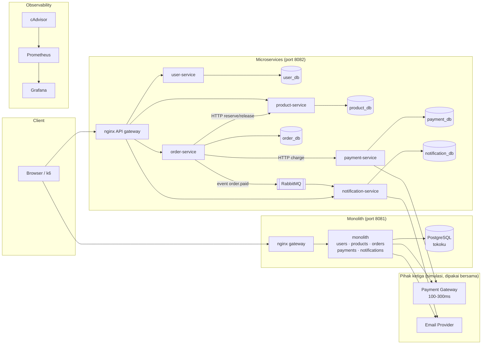

# TokoKu: Demo Monolithic vs Microservices

Proyek demo untuk webinar **"Monolithic vs Microservices: Scaling Strategies"**.
Isinya satu toko online fiktif, **TokoKu**, yang dibuat dalam **dua arsitektur** dengan logika bisnis yang **identik**.
Tujuannya supaya performa, pemakaian resource, strategi scaling, dan isolasi kegagalan bisa dibandingkan secara adil dan ditonton langsung oleh peserta.

| | Monolith | Microservices |
|---|---|---|
| Aplikasi | 1 aplikasi (Node.js, N worker) | 5 service: user, product, order, payment, notification |
| Database | 1 database bersama | 1 database **per service** (user tidak bisa akses DB service lain) |
| Komunikasi antar modul | function call | HTTP (sinkron) + RabbitMQ event (asinkron) |
| Konsistensi data | transaksi ACID | Saga + kompensasi |
| URL | http://localhost:8081 | http://localhost:8082 |

Yang disediakan:

- **Docker Compose** untuk menjalankan kedua arsitektur dengan resource limit yang setara.
- **Kubernetes**: manifest untuk k3s, HPA, dan kube-prometheus-stack.
- **k6**: 8 skenario (smoke, load, stress, spike, soak, fault injection, noisy neighbor, scaling).
- **Prometheus + Grafana + cAdvisor**: 3 dashboard yang sudah ter-provision otomatis.
- **Chaos panel** untuk mensimulasikan gangguan pihak ketiga (payment gateway lambat, email provider mati).
- **Storefront web** sederhana untuk demo visual. Halamannya menampilkan replika mana yang melayani tiap request.

---

## Arsitektur



Alur checkout (`POST /api/orders`) sama di kedua versi:
**validasi → fraud check (CPU) → kurangi stok → buat pesanan → bayar → kirim email konfirmasi.**
Alur ini ditulis **sekali** di [apps/shared/domain/orders.js](apps/shared/domain/orders.js). Monolit dan order-service hanya berbeda pada *adapter*-nya: function call di monolit, panggilan jaringan di microservices.

---

## Quick start (Docker)

**Prasyarat:** Docker 24+ dengan Docker Compose v2, `bash` (Linux/macOS, atau Git Bash/WSL di Windows), dan `curl`.
Rekomendasi minimal: **4 vCPU / 8 GB RAM** kalau ingin menjalankan semuanya sekaligus.

```bash
./scripts/demo.sh up
```

Perintah ini membuat network `tokoku`, mem-build semua image, lalu menjalankan infra, monolith, dan microservices.
Run pertama butuh beberapa menit (download image dan `npm install`).

| Apa | URL | Login |
|---|---|---|
| Storefront monolith | http://localhost:8081 | `user1@tokoku.test` / `password123` |
| Storefront microservices | http://localhost:8082 | sama |
| Grafana | http://localhost:3000 | `admin` / `tokoku` (anonim = viewer) |
| Prometheus | http://localhost:9090 | - |
| Chaos panel (pihak ketiga) | http://localhost:4000 | - |
| RabbitMQ management | http://localhost:15672 | `tokoku` / `tokoku` |
| cAdvisor | http://localhost:8080 | - |

Cek cepat bahwa semuanya berfungsi:

```bash
./scripts/demo.sh k6 smoke mono
```

```bash
./scripts/demo.sh k6 smoke ms
```

> **Penting untuk pengujian yang adil:** saat mengukur performa, nyalakan **hanya satu arsitektur** supaya keduanya tidak berebut CPU di mesin yang sama: `./scripts/demo.sh only mono` atau `./scripts/demo.sh only ms`.

Tanpa skrip helper (perintah Docker Compose manual):

```bash
docker network create tokoku
docker compose -f docker-compose.infra.yml up -d --build
docker compose -f docker-compose.monolith.yml up -d --build
docker compose -f docker-compose.microservices.yml up -d --build
```

---

## Perintah yang sering dipakai

```text
./scripts/demo.sh help
./scripts/demo.sh k6 load mono RATE=100 DURATION=3m      # load test
./scripts/demo.sh k6 stress ms MAX_RATE=600               # cari breaking point
./scripts/demo.sh k6 fault ms FAULT=email-down            # fault injection otomatis
./scripts/demo.sh scale ms order-service 3                # scale out 1 service
./scripts/demo.sh scale mono 3                            # scale out seluruh monolit
./scripts/demo.sh scale-up 4 4                            # scale up monolit: 4 CPU, 4 worker
./scripts/demo.sh chaos payment-slow                      # payment gateway lambat
./scripts/demo.sh kill ms notification-service            # matikan 1 service
./scripts/demo.sh reset-db mono                           # reset data sebelum run berikutnya
./scripts/demo.sh compare                                 # tabel hasil k6 (markdown)
```

## Skenario uji

| # | Skenario | File | Pertanyaan yang dijawab |
|---|---|---|---|
| 0 | Smoke | [k6/smoke.js](k6/smoke.js) | Semua endpoint berfungsi? |
| 1 | Load | [k6/load.js](k6/load.js) | Baseline latency & resource pada beban normal |
| 2 | Stress | [k6/stress.js](k6/stress.js) | Di RPS berapa sistem jenuh lalu patah? |
| 3 | Spike | [k6/spike.js](k6/spike.js) | Tahan lonjakan 10x (flash sale)? Berapa lama pulih? |
| 4 | Soak | [k6/soak.js](k6/soak.js) | Ada memory leak / degradasi dalam 1 jam? |
| 5 | Fault | [k6/fault.js](k6/fault.js) | Kalau email provider mati, apakah checkout ikut gagal? |
| 5b | Noisy neighbor | [k6/noisy-neighbor.js](k6/noisy-neighbor.js) | Kalau login membebani CPU, apakah katalog ikut lambat? |
| 6 | Scaling | [k6/scaling.js](k6/scaling.js) | Scale out 1 service vs seluruh monolit: mana lebih efisien? |

Penjelasan lengkap tiap skenario ada di [docs/03-skenario-uji.md](docs/03-skenario-uji.md).

## Dokumentasi

1. [Arsitektur & desain eksperimen](docs/01-arsitektur.md): kenapa perbandingannya adil, peta ke materi webinar, dan daftar metrik
2. [Panduan live demo](docs/02-panduan-demo.md): runbook langkah demi langkah untuk webinar, termasuk setup di VPS
3. [Skenario uji & analisis](docs/03-skenario-uji.md): parameter k6, cara membaca hasil, dan template laporan
4. [Kubernetes](docs/04-kubernetes.md): deploy ke k3s, HPA, dan monitoring
5. [Panduan sederhana](docs/05-panduan-sederhana.md): alur demo dengan bahasa sederhana, kalimat siap ucap, dan penjelasan setiap grafik Grafana

## Struktur folder

```text
apps/
  shared/              kode bersama: server HTTP, DB, metrik, auth, event bus
    domain/            LOGIKA BISNIS (dipakai monolit & microservices)
  monolith/            aplikasi monolit (modules/ = modular monolith)
  services/            5 microservice
  thirdparty-mock/     simulasi payment gateway & email provider + chaos panel
  Dockerfile           satu Dockerfile generik (build arg APP_DIR)
gateway/               konfigurasi nginx + storefront HTML
db/                    init SQL database-per-service
k6/                    skrip load test
monitoring/            Prometheus, Grafana (provisioning + dashboard + generator)
k8s/                   manifest Kubernetes (kustomize) + values Helm monitoring
scripts/               demo.sh, k8s.sh, compare-results.js
docker-compose.*.yml   infra | monolith | microservices
```

## API

Endpoint yang sama di kedua arsitektur (lewat gateway, prefix `/api`):

| Method | Path | Auth | Keterangan |
|---|---|---|---|
| POST | `/api/users/register` | - | `{name, email, password}` |
| POST | `/api/users/login` | - | `{email, password}` → `{token}`; CPU-bound (PBKDF2) |
| GET | `/api/users/me` | Bearer | profil |
| GET | `/api/products?page=&limit=&category=` | - | katalog (read-heavy) |
| GET | `/api/products/:id` | - | detail produk |
| POST | `/api/orders` | Bearer | `{items:[{product_id, qty}]}`: checkout |
| GET | `/api/orders` · `/api/orders/:id` | Bearer | riwayat / detail pesanan |
| GET | `/api/notifications?order_id=` | Bearer | status email konfirmasi |
| GET | `/api/info` | - | arsitektur yang sedang melayani |

Data seed: 1.000 produk (10 kategori) dan 1.000 user (`user1..user1000@tokoku.test`, password `password123`).

## Akses database (Navicat / DBeaver / psql)

PostgreSQL kedua arsitektur dibuka hanya di `127.0.0.1` (tidak bisa diakses dari internet).

| Arsitektur | Host | Port | User / Password | Database |
|---|---|---|---|---|
| Monolith | 127.0.0.1 | 15432 | `tokoku` / `tokoku` | `tokoku` (semua tabel) |
| Microservices (admin) | 127.0.0.1 | 15433 | `postgres` / `postgres` | `user_db`, `product_db`, `order_db`, `payment_db`, `notification_db` |
| Microservices (per service) | 127.0.0.1 | 15433 | `order_svc` / `order_svc`, dst. | hanya database miliknya, misalnya `order_db` |

Di VPS, gunakan **SSH tunnel** (tab *SSH* di Navicat: host VPS, port 22, user SSH), lalu isi host `127.0.0.1` dan port di atas pada tab *General*.
Port bisa diubah lewat `MONO_DB_PORT` / `MS_DB_PORT` di `.env`.

## Troubleshooting

- **`network tokoku declared as external, but could not be found`**: jalankan `docker network create tokoku` atau pakai `./scripts/demo.sh up`.
- **Panel container (cAdvisor) kosong di Docker Desktop (Windows/Mac)**: cAdvisor paling akurat di Linux. Dashboard utama tetap jalan karena memakai metrik dari proses aplikasi. Kalau log cAdvisor berisi `failed to identify the read-write layer ID`, versi cAdvisor terlalu lama untuk Docker dengan containerd image store. Gunakan v0.55.1 atau lebih baru (sudah menjadi default di compose).
- **Gateway mengembalikan 502 tepat setelah `up`**: service masih migrasi/seed database. Tunggu 10-20 detik.
- **Hasil k6 tidak muncul di Grafana**: pastikan k6 dijalankan dengan `--out experimental-prometheus-rw` (sudah otomatis lewat `demo.sh`) dan Prometheus dijalankan dengan `--web.enable-remote-write-receiver`.
- **Ingin mengubah dashboard**: edit [monitoring/grafana/generate_dashboards.py](monitoring/grafana/generate_dashboards.py), lalu jalankan `python monitoring/grafana/generate_dashboards.py`.
