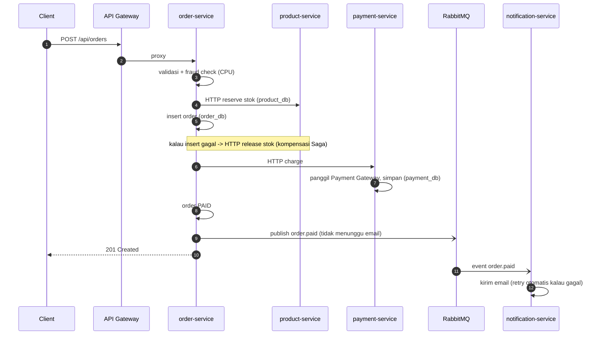

# 1. Arsitektur & Desain Eksperimen

## 1.1 Prinsip utama: perbandingan harus ADIL

Kesalahan paling umum saat membandingkan monolit dan microservices adalah membandingkan dua hal yang kondisinya tidak setara.
Kalau kondisinya berbeda, kita jadi mengukur perbedaan implementasi, bukan perbedaan arsitektur. Proyek ini menyamakan semua hal berikut:

| Aspek | Bagaimana disamakan |
|---|---|
| Bahasa & framework | Node.js 24 + Express 5 di semua aplikasi |
| Database | PostgreSQL 17, konfigurasi sama, limit **1 CPU / 1 GB** di kedua sisi |
| Logika bisnis | **Kode yang sama persis**: [apps/shared/domain/](../apps/shared/domain/). Monolit dan service hanya "membungkus" kode ini |
| Seed data | Deterministik (SQL `generate_series`): 1.000 produk, 1.000 user |
| Pihak ketiga | Container `thirdparty-mock` yang sama untuk kedua arsitektur |
| Total resource aplikasi | Monolit **2 CPU / 1 GB** = jumlah 5 service (**0.3+0.5+0.6+0.3+0.3 = 2 CPU**, 192+256+256+192+128 = **1 GB**) |
| Koneksi DB total | Monolit 2 worker × 10 = 20; microservices 3+6+6+3+2 = 20 |
| Gateway | nginx 1.28 dengan konfigurasi & limit sama (1 CPU) |
| Metrik | Nama & label identik (`arch="monolith"` / `arch="microservices"`) |

Satu-satunya tambahan di sisi microservices adalah **RabbitMQ (0.5 CPU / 512 MB)**. Ini sengaja dibiarkan karena memang termasuk **biaya nyata** microservices (infrastruktur tambahan), dan bisa dilihat di dashboard *Containers*.

## 1.2 Peta ke materi webinar (teknik migrasi)

| Teknik | Di mana terlihat di proyek ini |
|---|---|
| **Strangler Fig** | Kedua arsitektur diakses lewat **gateway nginx** dengan path yang sama (`/api/...`). Di gateway microservices, setiap path bisa diarahkan ke service baru satu per satu ([gateway/microservices.conf](../gateway/microservices.conf)). Untuk migrasi bertahap, cukup ubah satu `location` agar menunjuk ke service baru dan sisanya tetap ke monolit. |
| **Decomposition by business capability** | 5 service sesuai fungsi bisnis, bukan lapisan teknis: [apps/services/](../apps/services/). Di monolit, pembagian yang sama terlihat sebagai modul: [apps/monolith/modules/](../apps/monolith/modules/) (modular monolith). |
| **Database decoupling** | Setiap service punya database + user PostgreSQL sendiri dan **tidak punya hak akses** ke database lain ([db/microservices-init.sql](../db/microservices-init.sql)). `order_items` menyimpan **snapshot** `product_name` & `unit_price` saat transaksi, bukan JOIN ke tabel produk. |
| **Event-driven** | order-service mem-publish event `order.paid` ke RabbitMQ, lalu notification-service bereaksi sendiri. Kalau notification/email mati, checkout tetap sukses, dan pesan menunggu di antrean lalu dicoba ulang. |

## 1.3 Alur checkout: kode sama, "adapter" berbeda

[apps/shared/domain/orders.js](../apps/shared/domain/orders.js) berisi fungsi `checkout(input, ports)`. Dua arsitektur menyuntikkan *ports* yang berbeda:

```mermaid
sequenceDiagram
  autonumber
  participant C as Client
  participant M as Monolith (1 proses)
  participant DB as PostgreSQL (1 DB)
  participant PG as Payment Gateway
  participant EM as Email Provider
  C->>M: POST /api/orders
  M->>M: validasi + fraud check (CPU)
  M->>DB: BEGIN; kurangi stok; insert order; COMMIT (1 transaksi ACID)
  M->>PG: charge (100-300ms)
  M->>DB: payment SUCCESS, order PAID
  M->>EM: kirim email (SYNC: ditunggu)
  M-->>C: 201 Created
```



Hal yang bisa dibahas bersama peserta dari diagram ini:

- **Network hop**: monolit hanya punya 2 panggilan jaringan keluar (ke pihak ketiga), sedangkan microservices punya 4 atau lebih. Biayanya terlihat di panel *"Network hop cost"*.
- **Konsistensi**: monolit cukup memakai satu transaksi ACID. Microservices butuh kompensasi manual (Saga), sehingga kodenya lebih rumit dan ada lebih banyak titik kegagalan.
- **Coupling**: dengan `NOTIFICATION_MODE=sync`, gangguan email ikut menggagalkan checkout. Mode ini bisa diaktifkan di **kedua** arsitektur, jadi peserta bisa melihat bahwa isolasi kegagalan berasal dari **desain asinkron**, bukan semata-mata dari microservices.

| Mode notifikasi | Monolit (`MONO_NOTIFICATION_MODE`) | Microservices (`MS_NOTIFICATION_MODE`) |
|---|---|---|
| `sync` | **default**: kirim email di dalam request checkout | HTTP langsung ke notification-service ("distributed monolith") |
| `async` | antrean **in-memory** + retry (hilang kalau proses restart) | **default**: event RabbitMQ (durable, tahan restart) |

## 1.4 Beban CPU yang disimulasikan

Supaya bottleneck CPU bisa terlihat tanpa butuh traffic yang sangat besar, ada dua workload CPU yang realistis:

| Workload | Variabel | Default | Biaya kira-kira* |
|---|---|---|---|
| Hashing password (PBKDF2-SHA256) di login | `PASSWORD_HASH_ITERATIONS` | 100000 | ~25 ms CPU per login |
| "Fraud check" di setiap checkout | `FRAUD_CHECK_ROUNDS` | 2000 | ~6 ms CPU per order |

\* Diukur di laptop pengembang. Di vCPU VPS biasanya lebih lambat. Kalau ingin titik jenuh lebih cepat tercapai di demo, naikkan angkanya di `.env`. Nilainya **harus sama** untuk kedua arsitektur.

Node.js menjalankan JavaScript di **satu thread**. Monolit memakai `node:cluster` (`WORKERS`) agar bisa memakai lebih dari satu core ([apps/shared/cluster.js](../apps/shared/cluster.js)). Ini menjadi pelajaran *scale up*: menambah CPU tidak ada gunanya kalau aplikasinya tidak bisa memakainya, jadi `WORKERS` harus ikut dinaikkan.

## 1.5 Metrik yang tersedia

Semua aplikasi mengekspos `/metrics` di port 9100 (format Prometheus). Labelnya adalah `service` dan `arch`.

| Metrik | Jenis | Arti |
|---|---|---|
| `http_request_duration_seconds{method,route,status_code}` | histogram | RED: rate, error, durasi per route |
| `outbound_request_duration_seconds{target,status}` | histogram | panggilan keluar (antar service / pihak ketiga) |
| `db_query_duration_seconds{operation}` | histogram | latency query DB |
| `db_pool_connections{state=total\|idle\|waiting}` | gauge | `waiting > 0` = antre koneksi DB |
| `tokoku_orders_total{status}` | counter | hasil checkout: paid / payment_failed / notification_failed … |
| `tokoku_payments_total{status}` | counter | SUCCESS / DECLINED / ERROR |
| `tokoku_notifications_total{status,mode}` | counter | email sent / failed, sync / async |
| `tokoku_logins_total{result}` | counter | login sukses / gagal |
| `tokoku_events_published_total{event,result}` | counter | event ke RabbitMQ |
| `tokoku_notification_backlog` | gauge | antrean in-memory monolit (mode async) |
| `process_cpu_seconds_total`, `process_resident_memory_bytes` | default | CPU & RAM per proses (semua worker dijumlahkan) |
| `nodejs_eventloop_lag_p99_seconds` | default | event loop tersumbat = proses sibuk CPU |

Metrik dari sumber lain:

- **cAdvisor**: CPU/memory/network per container, termasuk **CPU throttling** dan persentase terhadap limit.
- **RabbitMQ**: `rabbitmq_queue_messages_ready` dan `rabbitmq_queue_messages_unacked` (backlog notifikasi).
- **k6** (remote write): `k6_http_req_duration_p95`, `k6_http_reqs_total`, `k6_http_req_failed_rate`, `k6_vus` dengan label `arch`, `test`, dan `name`.

### Dashboard Grafana

| Dashboard | Isi |
|---|---|
| **TokoKu: Live Demo** (home) | beban k6, RED per service/route, CPU/RAM/event loop/DB pool, antrean & pihak ketiga |
| **TokoKu: Containers (cAdvisor)** | CPU vs limit, throttling, memory vs limit, network per container, total per arsitektur |
| **TokoKu: Monolith vs Microservices** | stat & grafik berdampingan: p95, RPS, error, CPU, **efisiensi request per CPU-detik** |

## 1.6 Batasan eksperimen (sampaikan ke peserta)

- **Skala kecil, satu mesin, jaringan lokal.** Di produksi, latency antar service lintas node/zone lebih besar. Overhead microservices di sini cenderung *lebih kecil* daripada kenyataan.
- **Database per service masih satu server PostgreSQL** (logis terpisah). Di produksi biasanya terpisah fisik, sehingga isolasi lebih baik, tapi biaya juga lebih tinggi.
- **Tidak ada cache, CDN, atau read replica.** Optimasi seperti itu sering memberi dampak lebih besar daripada mengganti arsitektur.
- **Node.js single-thread** memperbesar efek *noisy neighbor* dibanding runtime multi-thread. Ini memang dimaksudkan untuk menonjolkan konsep, tapi jangan digeneralisasi ke semua bahasa.
- **Outbox pattern tidak diimplementasikan.** Kalau RabbitMQ mati tepat setelah order PAID, event bisa hilang. Ini disebut di kode sebagai catatan produksi.
